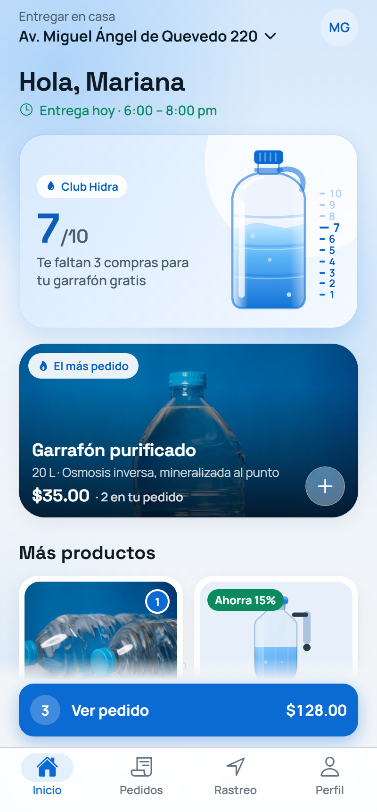
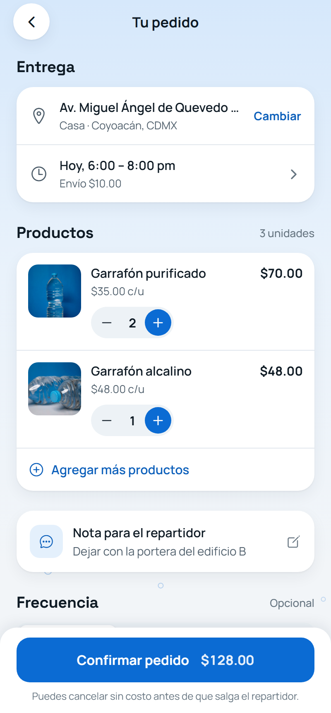
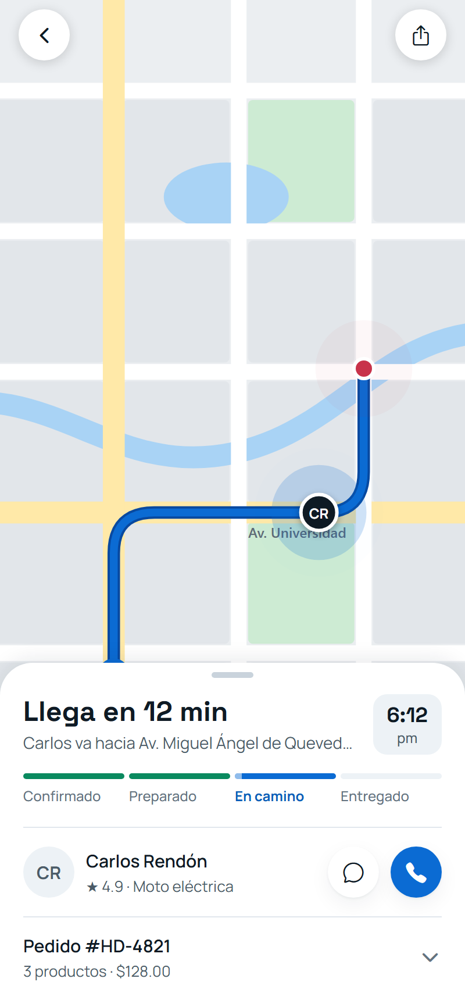
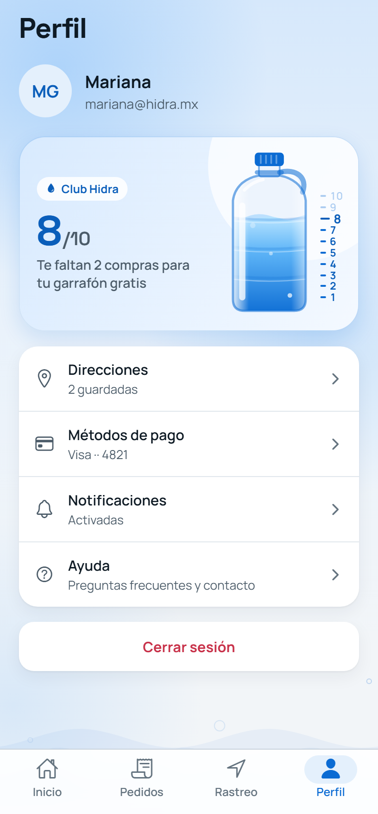
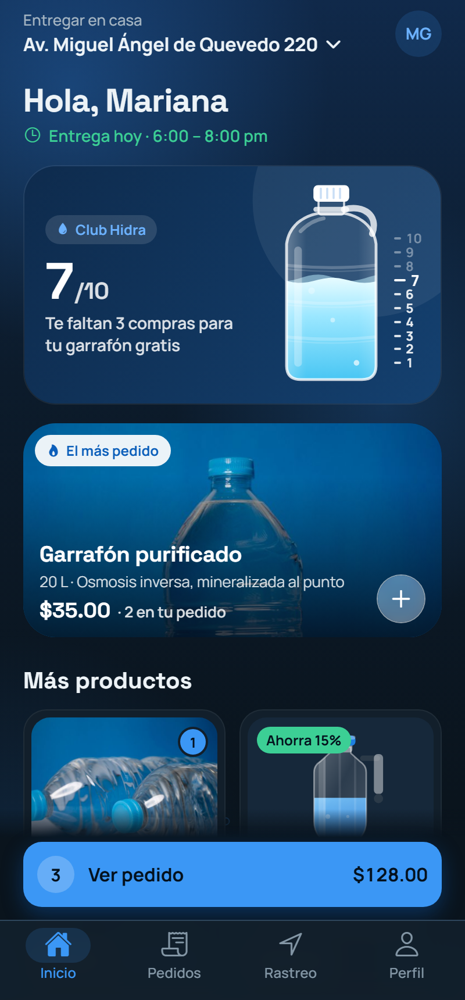
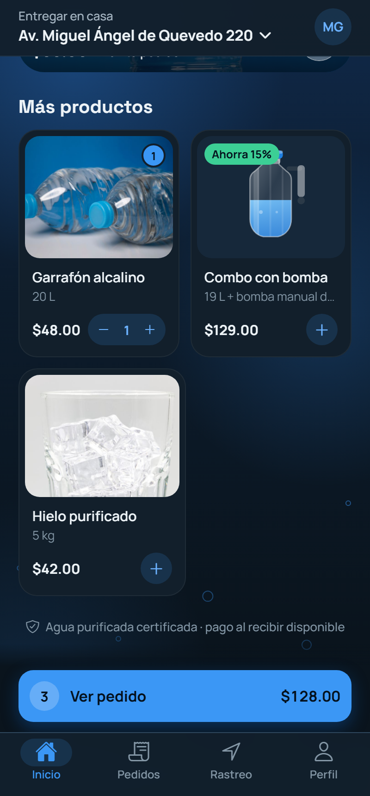
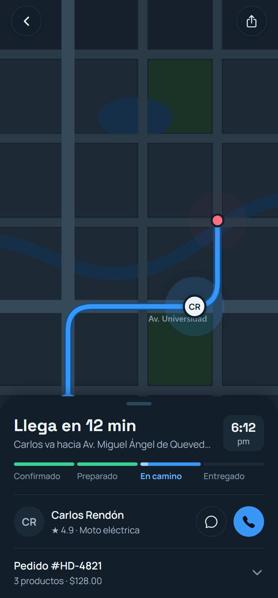
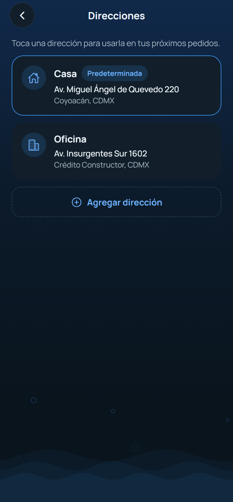

<p align="center">
  
</p>

<h1 align="center">Hidra</h1>

<p align="center">
  <strong>Water delivery, from tap to door.</strong><br />
  A mobile app for <strong>Purificadora Península</strong> to order purified-water jugs, pay, and track the delivery live.
</p>

<p align="center">
  <a href="https://github.com/AngelArteachi/purificadora-peninsula-app/actions/workflows/ci.yml"></a>
  
  
  
  
  
</p>

<p align="center">
  
  
  
  
</p>
<p align="center">
  
  
  
  
</p>

---

## Overview

Hidra is the customer app for **Purificadora Península**, a purified-water business that delivers 20 L jugs (*garrafones*) door to door in Mexico. Customers browse products, build an order, check out, and follow the courier on a map, while a loyalty card fills up with every purchase until they earn a free jug.

The interface is in **Spanish**, because that's what the business's customers speak. The code, docs and tooling are in English.

> **Status:** high-fidelity, fully interactive prototype. There is no backend yet: catalog, session, cart and loyalty live in memory, and payment is simulated. The data layer is isolated so it can be replaced with an API without touching the screens.

## Features

- **Ordering:** featured product, catalog grid with inline quantity steppers, and a floating cart bar whose total counts up as you add items.
- **Checkout:** editable address and delivery window, courier note, recurring delivery frequency, payment methods (cash, saved card with a 3D flip, convenience store / bank transfer), coupon validation, and an itemized summary.
- **Live tracking:** native map with route, courier and destination markers (`react-native-maps`); a vector map stands in on web.
- **Loyalty program (Club Hidra):** an animated 20 L jug whose water rises with each purchase, a measuring scale from 1 to 10 beside it, and a free jug unlocked at 10.
- **Profile:** saved addresses, payment preferences, notification settings, and an FAQ.
- **Light and dark mode:** follows the system setting live, including on web.
- **Resilient states:** empty states, image skeletons, and an offline banner that also blocks checkout.
- **Motion:** staggered entrances, spring-based interactions, haptics, and ambient water animations that pause when the screen is hidden or reduced motion is on.

## Tech stack

| Area | Choice |
| --- | --- |
| Framework | Expo SDK 58, React Native 0.88, React 19 |
| Language | TypeScript (strict) |
| Navigation | Expo Router: file-based routes, tabs, protected routes |
| Animation | React Native Reanimated 4 |
| Graphics | `react-native-svg` for the jug, map and brand art; `expo-linear-gradient`, `expo-blur` |
| Maps | `react-native-maps` (native), custom SVG fallback (web) |
| Media | `expo-image` |
| Device | `expo-haptics`, `expo-network`, `expo-system-ui` |
| Quality | ESLint (`eslint-config-expo`), `tsc --noEmit`, GitHub Actions CI |

Everything runs in **Expo Go**, so no custom native build is needed to try it.

## Getting started

**Requirements:** Node.js 20 or newer and npm. Optionally, the Expo Go app on your phone.

```bash
git clone https://github.com/AngelArteachi/purificadora-peninsula-app.git
cd purificadora-peninsula-app
npm install
npm start
```

Then scan the QR code with Expo Go (Android) or the Camera app (iOS), or press `w` to open it in the browser.

The login is pre-filled with demo credentials, so just tap **Iniciar sesión**. Try the coupon **`HIDRA10`** at checkout.

### Scripts

| Command | What it does |
| --- | --- |
| `npm start` | Start the Expo dev server |
| `npm run web` | Start and open the web build |
| `npm run lint` | Lint with ESLint |
| `npm run typecheck` | Type-check with `tsc --noEmit` |
| `npm run assets` | Regenerate the app icons, splash screens and favicon from SVG (Windows, uses Edge) |
| `npm run screenshots` | Walk through the app in headless Edge and refresh `docs/screenshots` (needs `npm run web` running) |

## Architecture

```text
src/
  app/                  Routes (Expo Router)
    _layout.tsx         Fonts, providers, session-protected stack
    login.tsx           /login, only reachable when signed out
    (tabs)/             Home, Orders and Profile, with a custom tab bar
    pago.tsx            /pago, checkout
    seguimiento.tsx     /seguimiento, live tracking
    ajustes/            /ajustes/*: addresses, payments, notifications, help
  components/
    ui/                 Design-system primitives: Card, Button, Field, Stepper, Segmented…
    order/              Product cards, loyalty card and jug, tab bar, delivery sheet
    checkout/           Order lines, payment methods, coupon field, summary
    map/                TrackingMap (native) and MockMap (web fallback)
    motion/             Reveal, CountUpMoney, Pulse, useMotionActive
  domain/               Pure business rules: totals, coupons, loyalty reward, MXN formatting
  state/                Session, cart and loyalty contexts (in memory)
  data/                 Catalog, addresses, delivery windows, sample route
  hooks/                useIsOnline
  theme/                Palettes, useTheme, makeStyles, type scale
scripts/                Asset generation, screenshot tour, static server
```

A few decisions worth calling out:

- **Business logic is pure and UI-free.** `src/domain` computes cart totals, validates coupons and applies the loyalty reward. Screens only render the results, so the rules can move to a server or be unit-tested on their own.
- **Theming by role, not by color.** Light and dark palettes share the same semantic keys (`surface`, `textSecondary`, `primary`…). Components ask for a role through `makeStyles((t) => …)`, which builds and caches one `StyleSheet` per scheme, so components don't hard-code theme colors.
- **Protected routes.** The root stack uses `Stack.Protected` guards keyed on the session, so signing in or out is just a state change and the router handles the redirect.
- **Motion that respects the device.** `useMotionActive` combines screen focus, app foreground state and the reduced-motion setting, and every looping animation listens to it. Tabs stay mounted, so without it hidden screens would keep animating.
- **Platform-specific modules.** `TrackingMap.tsx` and `TrackingMap.web.tsx` keep the native map out of the web bundle.

## Design

| Role | Light | Dark |
| --- | --- | --- |
| Background | `#F2F5F8` | `#0A141D` |
| Surface | `#FFFFFF` | `#121F2B` |
| Text | `#0E1A24` | `#EDF3F7` |
| Primary | `#0B6BD3` | `#3B97F5` |
| Success | `#0A8A5F` | `#3CCF95` |

**Typography:** Space Grotesk for headings and prices, Manrope for everything else. Body text is 15 pt, and nothing user-facing goes below 12 pt.

**Accessibility:** controls carry accessible labels, roles and states, text follows the system font size, and decorative animations stop when reduced motion is on.

## Roadmap

- [ ] Backend API for the catalog, orders and loyalty, with persistent sessions
- [ ] Real payments and push notifications for order status
- [ ] Directions API for the courier route
- [ ] Unit tests for `src/domain` and component tests for checkout
- [ ] EAS build profiles and store listings

## Credits

Product photos are from [Pexels](https://www.pexels.com/license/) (free for commercial use); see [`assets/products/CREDITS.md`](assets/products/CREDITS.md). The app icon, illustrations and map are original vector art.

## License

[MIT](LICENSE)
